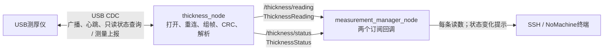
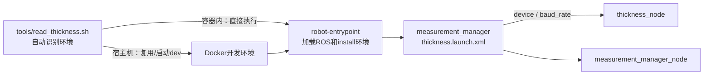

# 双磁轮检测机器人 ROS 2 上位机

本仓库在Jetson Orin Nano + 达妙载板上开发。当前先完成USB测厚仪读取与终端观察，后续逐项接入参数管理、上下位机通信、数传和视频。

下位机固件独立维护：[Dual_magnetic_wheel-robot](https://github.com/pingqiaoL/Dual_magnetic_wheel-robot)。MK32界面独立开发。上下位机目标仍为XRCE-DDS Client/Agent，本轮未实现。

## 当前进度

截至2026-10-15，本轮简化已完成：

- 三个包重新构建通过；只保留采集、订阅打印两个节点及两个消息结构。
- 已删除旧bringup、测量门控、滤波、CSV、业务服务和多余MCU消息；原协议库、端口库及字节环形缓冲保留。
- XML launch已按包安装；宿主机read_thickness.sh已验证参数透传、重复运行保护、SIGINT/SIGTERM退出清理。
- 两项底层CTest通过；实际宿主机脚本 + XML + C++节点配合PTY模拟仪器，8条测量/NaN打印、坏CRC丢弃、重连恢复均通过。
- 真实USB只读检查识别CT260918B002并显示“通信正常，等待测量上报”；本轮15秒内真实厚度0条，不代表测厚精度已验收。当前单位固定unknown。
- 统一参数系统、真实上下位机XRCE-DDS、数传、视频、自启动均未实现。没有提交或推送Git。

## 启动读取

在Orin宿主机SSH或NoMachine终端执行：

```bash
bash /home/nvidia/robot_ros2/tools/read_thickness.sh device:=/dev/ttyACM0 baud_rate:=115200
```

如果终端提示符是robot@ubuntu:/workspace，表示已在容器内，执行：

```bash
bash /workspace/tools/read_thickness.sh device:=/dev/ttyACM0 baud_rate:=115200
```

脚本自动识别环境，容器内不会调用Docker；宿主机才复用或启动dev容器。

本轮已编译，无需重新编译即可读取；Ctrl+C退出本次两个节点，开发容器保留。设备路径是容器内路径；不要同时运行其他程序读取同一端口。查看帮助使用脚本的--help。

宿主机Ubuntu20.04.6 / Jetson Linux R35.6.1，开发容器为Ubuntu24.04 / ROS2 Jazzy ARM64，默认DDS域42、CycloneDDS、LOCALHOST。宿主机工程与容器/workspace为同一挂载文件，不在宿主机安装另一套Jazzy软件源。

## 当前代码树

此树区分现有文件和末尾的后续规划，不将已删除的旧功能继续标为当前实现。

<!-- ARCHITECTURE_TREE_START -->
```text
robot_ros2/                                    # Orin宿主机 /home/nvidia/robot_ros2；容器 /workspace
├── src/                                     # 当前只有以下三个ROS包
│   ├── robot_interfaces/                    # [已构建] 两个消息结构，无独立节点
│   │   ├── CMakeLists.txt                    # 生成消息的C++/Python类型支持
│   │   ├── package.xml                       # 消息生成依赖
│   │   └── msg/
│   │       ├── ThicknessReading.msg           # 原始读数、时间、序号、SN、单位、材料原码
│   │       └── ThicknessStatus.msg            # 端口、通信、报文年龄与错误统计
│   ├── thickness_usb_driver/                # [已构建] USB采集与协议解析
│   │   ├── CMakeLists.txt                    # 底层库、采集节点和两项测试
│   │   ├── package.xml                       # rclcpp、启动参数描述、消息依赖
│   │   ├── include/thickness_usb_driver/
│   │   │   ├── UsbCdcPort.hpp                 # Linux端口配置、打开、限时读写
│   │   │   ├── ByteRingBuffer.hpp             # 有界字节环形缓冲，辅助组帧
│   │   │   ├── ThicknessProtocol.hpp          # 协议帧、CRC和字段解析接口
│   │   │   └── ThicknessNode.hpp              # 采集节点声明和固定通信时序
│   │   ├── module/                          # 普通C++功能实现，不是ROS节点
│   │   │   ├── UsbCdcPort.cpp                 # open/termios/poll/read/write和RAII
│   │   │   └── ThicknessProtocol.cpp          # 半帧/多帧、CRC、只读请求与解码
│   │   ├── src/ThicknessNode.cpp             # 节点：连接、心跳、重连、发布；底部main
│   │   └── test/
│   │       ├── ProtocolFixtures.hpp           # 已知协议报文与测试构帧
│   │       ├── test_thickness_protocol.cpp    # 分帧、CRC、异常值与恢复
│   │       └── test_usb_port.cpp              # Linux伪终端、超时、回压、断开
│   └── measurement_manager/                 # [已构建] 当前只订阅打印，不含业务门控或滤波
│       ├── CMakeLists.txt                    # 编译打印节点，安装XML launch
│       ├── package.xml                       # ROS消息、采集包、XML启动运行依赖
│       ├── include/measurement_manager/
│       │   └── MeasurementManagerNode.hpp     # 两个订阅器和私有打印函数
│       ├── src/MeasurementManagerNode.cpp     # 读数逐条打印，状态变化时提示；底部main
│       └── launch/thickness.launch.xml        # [已安装/验证] 两节点及device/baud_rate启动参数
├── tools/
│   ├── read_thickness.sh                    # [已验证] 宿主机/容器自适应启动、传参和退出清理
│   ├── dev.sh                               # 既有容器构建、进入与执行辅助工具
│   ├── install_docker_host.sh               # 既有宿主机Docker安装脚本
│   ├── install_user_buildx.py                # 既有Buildx工具
│   └── verify_dev_environment.py             # 历史环境检查，不是当前MCU链路实现
├── docker/                                  # 既有Jazzy镜像、入口与环境文件
│   ├── Dockerfile
│   ├── base-image.lock.json
│   ├── requirements-dev.txt
│   ├── entrypoint.sh
│   └── ros_env.sh
├── .devcontainer/devcontainer.json          # 既有VS Code容器入口
├── .vscode/settings.json                     # 既有编辑器设置
├── test/                                    # 既有独立USB协议工具，不是ROS包
│   ├── README.md / .gitignore
│   ├── usb_protocol_lab.py / raw_capture.py
│   ├── vendor_probe.py / vendor_readonly.py
│   ├── verify_received.py
│   └── results/                             # 历史实测数据，忽略Git
├── docs/
│   ├── 2026-10-15开发文档.md                  # 历史实现、分步调整、最终清理和验证记录
│   ├── 测厚节点使用说明.md                    # 当前构建、脚本、输出与数据边界
│   ├── 上位机代码目录框架.md                  # 与README同步的树
│   ├── 上位机节点通信图.md                    # 当前发布/订阅与启动关系
│   ├── 参数管理设计.md                        # 后续规划；当前仅有两个启动选项
│   ├── 上下位机XRCE-DDS可行性.md              # 后续链路与资源验证计划
│   ├── 摄像头与测厚仪接入说明.md              # 接入与历史排查说明
│   ├── Docker与ROS2开发环境.md                # 既有环境说明
│   └── 2026-10-14开发文档.md                  # 历史记录保留
├── log/                                     # 构建日志、测试报告、修改前备份；忽略Git
├── build/ / install/                         # 生成物；旧bringup生成物已清理
├── data/                                    # 原有数据保留；当前节点不写CSV
├── compose.yaml                             # 既有开发容器和USB映射
├── AGENTS.md                                # 开发与文档规则
├── .dockerignore / .gitignore / .gitattributes
└── README.md

后续规划，当前未创建/未运行：
  robot_config_manager          # 参数统一查询、校验、保存与可视化入口
  cboard_dds_bridge              # XRCE Agent集成和真实MCU状态接入
  measurement_status_transmission # 独立地面数传节点
  video_streamer_transmission   # 视频采集、编码和网络传输
  测厚滤波/记录/就绪门控         # 本轮已撤回，待逐项重新实现
```
<!-- ARCHITECTURE_TREE_END -->

## 当前通信关系





当前只有两条测厚话题，没有/measurement/sample、/measurement/state、测量启停服务或MCU消息订阅。两个消息定义由robot_interfaces生成；measurement_manager当前仅打印，名称保留便于以后逐步扩展。

## 开发与后续

节点.cpp在各包src，普通实现.cpp在module，头文件在include/<包名>，main在对应节点文件底部。本轮按已审批方案完成剩余清理和安装；后续继续逐文件说明和修改。框架发生结构变化时先给出候选方案，经用户审批后同步README、架构文档、通信图和开发记录。

独立参数统一入口、滤波/记录、真实MCU链路、地面数传、视频和产品自启动后续实现。当前脚本是人工调试启动入口，不是开机自启动部署。

源码与文档尚未提交/推送；build、install、log、采集数据和凭据不提交Git，原有历史记录与备份保留。

## 文档

- [测厚节点使用说明](docs/测厚节点使用说明.md)
- [代码目录框架](docs/上位机代码目录框架.md)
- [节点通信图](docs/上位机节点通信图.md)
- [参数管理后续规划](docs/参数管理设计.md)
- [2026-10-15开发记录](docs/2026-10-15开发文档.md)
- [Docker与ROS2开发环境](docs/Docker与ROS2开发环境.md)
- [上下位机XRCE-DDS可行性](docs/上下位机XRCE-DDS可行性.md)
