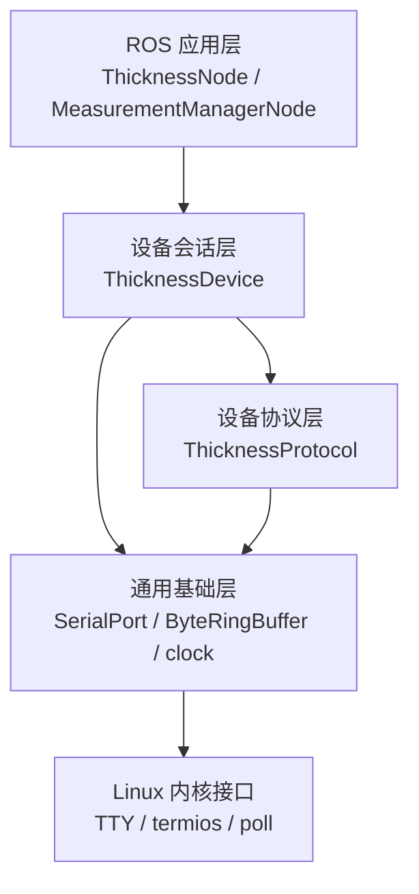
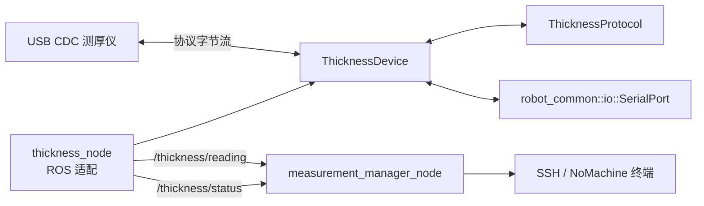

# 双磁轮检测机器人 ROS 2 上位机

本仓库是运行在 Jetson Orin Nano + 达妙载板上的 ROS 2 上位机工作区。当前完成 USB CDC 测厚仪的设备通信、协议解析、ROS 发布和终端观察；运动控制仍由 STM32 下位机承担。

下位机固件独立维护于 [Dual_magnetic_wheel-robot](https://github.com/pingqiaoL/Dual_magnetic_wheel-robot)。上下位机 XRCE-DDS、统一参数管理、测厚滤波与存储、数传、视频和 UI 仍处于规划阶段。

## 当前能力

截至 2026-10-16：

- `ThicknessNode` 只负责 ROS 参数、定时调度、消息转换和发布。
- `ThicknessDevice` 负责打开设备、发现、心跳、状态查询、超时和断线重连。
- `ThicknessProtocol` 负责构帧、拆帧、CRC 和字段解码。
- `robot_common` 提供可复用的单调时钟、数值限制、字节环形缓冲和 Linux TTY 串口访问。
- `measurement_manager_node` 订阅读数和状态并打印，暂不做滤波、写盘或业务门控。
- 4 个 ROS 包构建通过；4 项自动测试全部通过，无错误、失败或跳过。
- 重构后尚未占用真实测厚仪回归；实机识别和协议握手结论来自重构前记录，计量精度仍待标定片验收。

## 快速启动

在 Orin 宿主机 SSH 或 NoMachine 终端执行：

```bash
bash /home/nvidia/robot_ros2/tools/read_thickness.sh \
  device_path:=/dev/ttyACM0 baud_rate:=115200
```

如果提示符为 `robot@ubuntu:/workspace`，说明已经在开发容器内：

```bash
bash /workspace/tools/read_thickness.sh \
  device_path:=/dev/ttyACM0 baud_rate:=115200
```

脚本在宿主机复用或启动开发容器，在容器内直接运行已安装的 XML launch。按 `Ctrl+C` 停止两个节点。设备路径是容器内路径，同一时刻不要用其他程序打开相同端口。

开发环境为 Ubuntu 20.04.6 / Jetson Linux R35.6.1 宿主机，以及 Ubuntu 24.04 / ROS 2 Jazzy ARM64 容器。

## 软件分层



依赖只向下：节点不判断端口错误和在线状态；设备层不发布 ROS 消息；协议层不打开硬件；公共库不知道具体仪器协议。

## 当前代码树

<!-- ARCHITECTURE_TREE_START -->
```text
robot_ros2/                                      # 宿主机 /home/nvidia/robot_ros2；容器 /workspace
├── src/
│   ├── robot_interfaces/                      # ROS 消息定义，无节点
│   │   └── msg/
│   │       ├── ThicknessReading.msg            # 原始测厚读数
│   │       └── ThicknessStatus.msg             # 设备通信状态与错误统计
│   ├── robot_common/                          # 通用 C++ 库，无 ROS 节点
│   │   ├── include/robot_common/
│   │   │   ├── buffer/ByteRingBuffer.hpp       # 单线程有界字节环形缓冲
│   │   │   ├── clock/SteadyClock.hpp           # 单调时间、年龄和截止时间
│   │   │   ├── io/SerialPort.hpp               # Linux TTY 串口接口
│   │   │   └── math/Saturation.hpp             # 整数范围限制
│   │   ├── module/
│   │   │   ├── SerialPort.cpp                  # open/termios/poll/read/write/close
│   │   │   └── SteadyClock.cpp                 # 单调时间实现
│   │   └── test/
│   │       ├── test_robot_common.cpp           # 时间与数学边界测试
│   │       └── test_serial_port.cpp            # 伪终端读写、超时和断开测试
│   ├── thickness_usb_driver/                  # 测厚设备、协议和 ROS 适配
│   │   ├── include/thickness_usb_driver/
│   │   │   ├── ThicknessTypes.hpp              # 普通 C++ 配置、帧、测量和状态类型
│   │   │   ├── ThicknessProtocol.hpp           # 协议构帧、拆帧和解码接口
│   │   │   ├── ThicknessDevice.hpp             # 设备会话与恢复策略接口
│   │   │   └── ThicknessNode.hpp               # ROS 适配节点声明
│   │   ├── module/
│   │   │   ├── ThicknessProtocol.cpp           # 帧常量、CRC、缓存和字段解码
│   │   │   └── ThicknessDevice.cpp             # 打开、读写、周期请求和状态机
│   │   ├── src/ThicknessNode.cpp               # 参数、定时器、消息发布及 main
│   │   └── test/
│   │       ├── ProtocolFixtures.hpp             # 已知报文和测试构帧
│   │       ├── test_thickness_protocol.cpp      # 分帧、CRC、恢复和解码测试
│   │       └── test_thickness_device.cpp        # 伪终端设备会话测试
│   └── measurement_manager/                   # 当前为订阅打印节点
│       ├── include/measurement_manager/
│       │   └── MeasurementManagerNode.hpp
│       ├── src/MeasurementManagerNode.cpp
│       └── launch/thickness.launch.xml          # 两节点及启动参数
├── tools/
│   ├── read_thickness.sh                       # 宿主机/容器自适应启动入口
│   ├── dev.sh                                  # 开发容器辅助脚本
│   └── install_docker_host.sh                  # 宿主机 Docker 安装脚本
├── docker/                                    # Jazzy ARM64 开发镜像和入口
├── docs/
│   ├── README.md                               # 文档导航
│   ├── 文档编写规范.md                         # 文档类型、状态和维护规则
│   ├── architecture/                          # 系统架构、目录和运行流程
│   ├── modules/                               # 模块职责、接口和异常处理
│   ├── guides/                                # 环境、启动和调试步骤
│   ├── reference/                             # ROS 接口和设备接入事实
│   ├── decisions/                             # 架构决策记录 ADR
│   ├── testing/                               # 测试计划与验收范围
│   ├── planning/                              # 尚未实现的设计方案
│   └── 2026-10-16开发文档.md                    # 当日任务、过程和验证证据
├── test/                                      # 独立 USB 协议实验工具
├── compose.yaml                               # 开发容器和设备映射
└── README.md

规划中，当前未创建或未运行：
  robot_config_manager                         # 参数查询、校验、保存和可视化入口
  cboard_dds_bridge                            # XRCE-DDS Agent 与下位机状态接入
  measurement_status_transmission              # 测厚数据数传
  video_streamer_transmission                  # 视频采集、编码和网络传输
  测厚滤波、记录和就绪门控                      # 在 measurement_manager 中逐项实现
```
<!-- ARCHITECTURE_TREE_END -->

## 当前通信关系



当前只有 `/thickness/reading` 和 `/thickness/status` 两个话题。没有测量启停服务、样本历史缓存、统一参数节点或 MCU 消息订阅。

## 构建与测试

```bash
cd /workspace
source /opt/ros/jazzy/setup.bash
colcon build --packages-up-to measurement_manager --event-handlers console_direct+
source /workspace/install/setup.bash
colcon test --packages-select robot_common thickness_usb_driver \
  --event-handlers console_direct+
colcon test-result --verbose
```

自动测试覆盖公共时间和数值边界、TTY 伪终端读写、协议分帧与 CRC，以及完整设备会话。真实硬件通信和计量精度必须单独验收。

## 文档

- [文档导航](docs/README.md)
- [系统架构](docs/architecture/系统架构.md)
- [代码目录](docs/architecture/代码目录.md)
- [节点通信与运行流程](docs/architecture/节点通信与运行流程.md)
- [测厚采集模块](docs/modules/测厚采集模块.md)
- [测厚仪读取与调试](docs/guides/测厚仪读取与调试.md)
- [ROS 接口与参数](docs/reference/ROS接口与参数.md)
- [架构决策：测厚模块分层](docs/decisions/ADR-0001-测厚模块分层方案.md)
- [2026-10-16 开发记录](docs/2026-10-16开发文档.md)

框架发生结构变化时，先提交候选方案供审批；批准后同步修改代码、README、架构文档、模块说明和当天开发记录。
