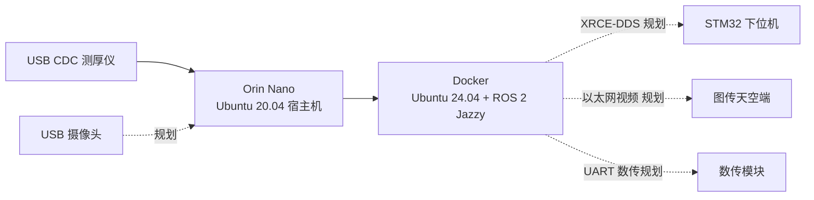
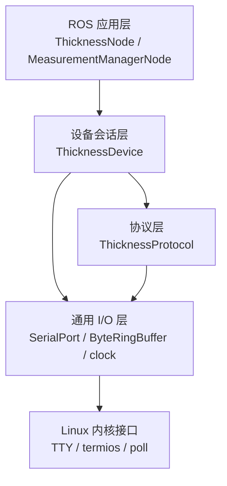

# 双磁轮检测机器人上位机系统架构

文档状态：现行  
实现状态：测厚链路已实现并完成软件验证；其余业务链路仍在规划  
适用版本：2026-10-16 工作区未提交  
更新日期：2026-10-16

## 1. 目标与边界

上位机运行在 Jetson Orin Nano 达妙载板上，负责设备采集、数据处理、视频处理、人机界面以及与 STM32 下位机和地面端通信。当前仓库已实现 USB CDC 测厚仪读取和终端观察；运动控制仍由 STM32 下位机承担。

## 2. 部署视图

宿主机工程 `/home/nvidia/robot_ros2` 映射为容器 `/workspace`。USB 设备节点映射进入开发容器，ROS 2 程序在容器内构建和运行。

## 3. 软件分层

依赖方向只向下。`robot_common` 不包含 ROS 节点和具体仪器业务；设备层不发布 ROS 消息；节点不判断端口打开失败、协议应答超时或重连策略。

## 4. 当前 ROS 组件

| 组件 | 状态 | 职责 |
|---|---|---|
| `thickness_node` | 已实现、软件验证 | 参数接入、定时调度、ROS 消息转换和发布 |
| `measurement_manager_node` | 已实现、软件验证 | 订阅读数和状态并在终端打印 |
| `robot_interfaces` | 已实现 | 定义测厚读数和通信状态消息 |
| `robot_common` | 已实现、单元测试 | 单调时钟、整数范围、字节缓冲和 Linux TTY 串口 |

## 5. 规划组件

统一参数管理、上下位机 XRCE-DDS、数据滤波与本地存储、数传、视频采集编码、UI 和开机自启动尚未形成产品能力。它们接入时应遵守本文件的依赖方向，并为新的关键架构选择建立 ADR。

## 6. 质量目标

- 设备断开后能够释放描述符并按固定间隔重连。
- 协议坏帧不能直接造成进程退出，解析器能重新同步。
- 设备业务代码不依赖 ROS，能够使用伪终端和已知报文独立测试。
- 节点只承担 ROS 适配，设备和协议状态由普通 C++ 层统一判断。
- 文档中的已验证结论能够追溯到自动测试或实机记录。

## 7. 风险与技术债

- 测厚单位、材料码和计量精度仍待厂家确认及实机验收。
- 10 ms ROS 定时器内执行同步有界 I/O；写超时当前为 20 ms，因此它不是硬实时循环。
- 串口类只覆盖当前需要的 raw、8N1、无流控配置，后续设备可能需要扩展配置结构。
- 摄像头使用 V4L2/编解码链路，不能复用 TTY 串口实现。
