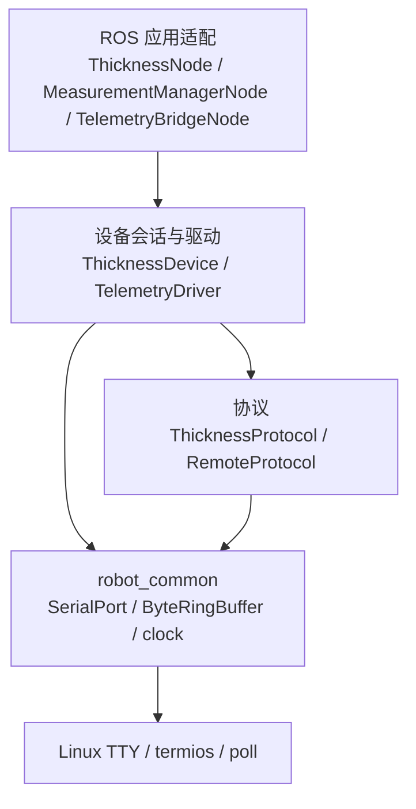
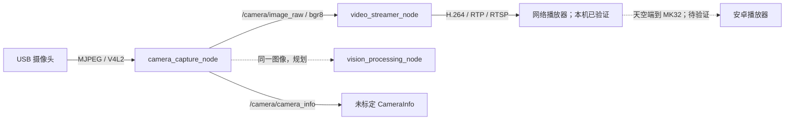

# 双磁轮检测机器人上位机系统架构

文档状态：现行
实现状态：测厚数传及视频采集、H.264/RTSP 已实现；真实摄像头本机回环通过，无线播放待测
适用版本：2026-10-22 工作区修改
更新日期：2026-10-22

## 目标与部署

上位机运行在 Jetson Orin Nano + 达妙载板。宿主机 Ubuntu 20.04.6，开发容器 Ubuntu 24.04 / ROS 2 Jazzy。宿主机 `/home/nvidia/robot_ros2` 映射到容器 `/workspace`。

当前用户接线是测厚 USB CDC 到 `/dev/ttyACM0`，天空端数传到载板串口 1；载板 TX203/RX205 对应当前设备树 `serial@3100000`，Linux 节点 `/dev/ttyTHS0`，数传 115200、8N1。

Orin 与 MK32 安卓使用 MAVLink 2。Orin 与 STM32 的目标仍为 XRCE-DDS，尚未接入。车辆和起降机构的闭环控制由下位机承担。

## 组件职责

| 组件 | 当前职责 |
|---|---|
| thickness_node | 参数、调度和原始读数/仪器状态发布 |
| ThicknessDevice / ThicknessProtocol | 仪器会话、发现、心跳、解析与重连 |
| measurement_manager_node | 原始值打印、持续测量开关、有效结果发布 |
| telemetry_bridge_node | 直接接收有效新结果、新鲜度检查，提交 THICKNESS 和 STM_LINK 业务数据 |
| TelemetryDriver / RemoteProtocol | 后台事件循环、数传串口、有界队列、过期丢弃、重连和 MAVLink 链路协议 |
| robot_common | 单调时钟、整数边界、字节缓存、通用 TTY I/O |
| robot_interfaces | 原始测厚、仪器状态、测量结果三种消息 |

## 分层与依赖

依赖向下，普通设备和协议层不发布 ROS 消息。公共库不包含测厚协议或 MAVLink 业务。manager 当前采用小型布尔开关，暂不提取多阶段测量会话类。

## 业务过程

manager 当前启动默认开启，持续发布有效新读数，没有新数据不重发。后续下位机状态回调调用 on_measurement_ready(bool)，当前尚未建立该订阅，也不提供测厚启停服务。发布数据不清零开关。

数传直接订阅结果；取消停止 manager 后续发布，已排队/在途数据可能继续发送。应用节点提交业务数据，`TelemetryDriver` 的单一工作线程通过 `poll()` 同时等待串口和内部 `eventfd`，自动处理读写、MAVLink 心跳、PING 应答与重连。ROS 节点不再周期调用底层 I/O。实时发送采用有界队列和过期丢弃，当前不提供完整检测记录、确认补传或无线送达保证。

## 质量与限制

- manager 退出后不产生新结果，排队数据排空或过期后停止测厚输出；没有独立的开关心跳超时。
- 串口重连和堵塞在数传驱动工作线程中处理，应用回调不等待串口。
- 协议 CRC、拆帧和 PTY 会话可脱离硬件测试。
- 测厚采集、ROS 消息和安卓显示统一使用 µm；数传不再进行单位门控。
- 安卓解码器把测厚消息也计为 STM32 在线，尚需后续纠正，不能用其图标验收下位机。
- 统一参数管理、滤波、存储、XRCE-DDS 和开机自启动均未实现。

## 视频采集和上传

`camera_driver` 与 `video_streamer_transmission` 已按批准框架实现。XML 将两个可组合节点加载到同一 `component_container_mt` 进程，开启进程内通信。采集拥有独立工作线程和唯一摄像头句柄，视频工作线程持有最新帧引用；ROS 订阅回调不执行编码。

ROS 图像为 BestEffort / Volatile / KeepLast1，消费者使用只读 `ConstSharedPtr`。采集 GStreamer 输出复制为紧凑 bgr8，移动到 ROS 消息；视频工作线程复制到 GStreamer 输入，不承诺整条链路零复制。CPU 视觉算法如需修改像素，必须复制自己的工作图像。

视频先监听 RTSP，客户端连接后开始编码；相机一直采集以供后续视觉算法使用。停止 `/video/set_enabled` 不停止采集。输入停顿时不重放旧图像，状态变为 WAITING_FRAME。配置与错误边界见 [视频模块](../modules/视频模块.md)。
