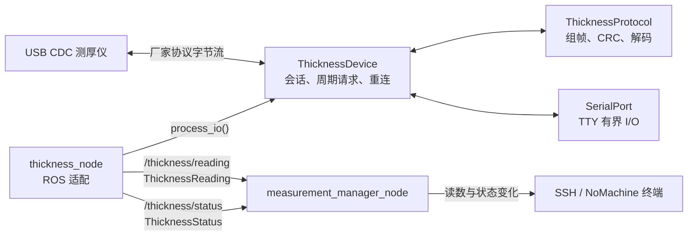
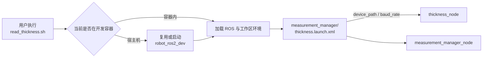
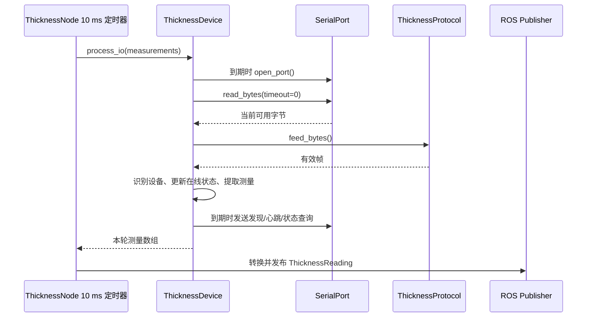

# 上位机节点通信与运行流程

文档状态：现行  
实现状态：测厚链路已完成软件验证  
适用版本：2026-10-16 工作区未提交  
更新日期：2026-10-16

## ROS 节点通信

`ThicknessDevice`、`ThicknessProtocol` 和 `SerialPort` 是同一采集进程内的 C++ 对象，不是 ROS 节点，也不创建 DDS 话题。

## 启动流程

shell 脚本解决宿主机和容器环境差异；XML launch 负责声明启动参数并组合节点；C++ 节点负责运行逻辑。三者职责不能互相替代。

## 采集周期

状态由另一个 500 ms ROS 定时器读取 `ThicknessDevice::status()` 并发布。节点不重复实现通信判断。

## 当前 ROS 接口

| 接口 | 发布者 | 订阅者 | QoS | 用途 |
|---|---|---|---|---|
| `/thickness/reading` | `thickness_node` | `measurement_manager_node` | Reliable、KeepLast 64、Volatile | 发布 CRC 和字段校验后的原始读数 |
| `/thickness/status` | `thickness_node` | `measurement_manager_node` | Reliable、KeepLast 1、Volatile | 发布连接、在线、年龄和错误统计 |

状态为 `ONLINE` 只说明端口打开、设备已识别且最近应答未超时，不代表探头接触到位、机器人准备完成或计量精度合格。

## 当前边界

- `device_path` 和 `baud_rate` 是启动时只读参数，修改后需要重启节点。
- 当前没有统一参数管理节点、运行时热更新、测量启停服务或下位机就绪门控。
- `measurement_manager_node` 当前只打印，不发布滤波结果，也不写入本地文件。
- XRCE-DDS、数传和视频链路属于后续系统通信，不应塞入测厚节点。
