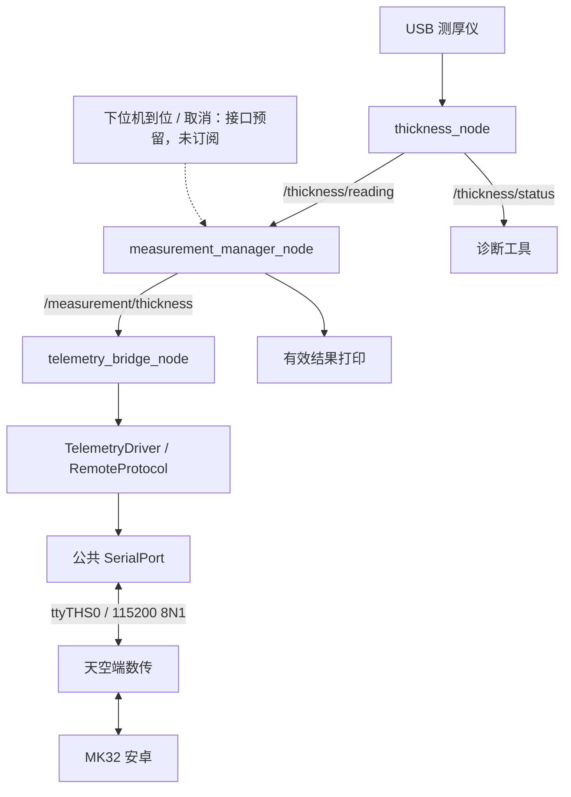
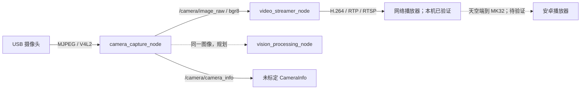

# 上位机节点通信与运行流程

文档状态：现行；更新日期：2026-10-22。
测厚管理职责已精简；本轮验证范围见当天开发记录。真实下位机状态订阅仍未实现。

## 当前通信图



manager 默认开启。未来下位机订阅在本节点回调内调用 `on_measurement_ready(true/false)`，目前不创建虚构的下位机话题。启动脚本、端口和运行指令见 [模块测试](../module_test.md)。

## 事件与职责

1. 驱动持续采集，收到新测量后发布 ThicknessReading；业务关闭不会停止 USB 通信。
2. manager 收到读数，在开关开启、数据有限且接收时间不早于开启时间时直接发布 ThicknessReading。
3. 每条新消息转发一次；同值新消息仍发布。无输入时不定时重发，发布后开关不清零。
4. 数传直接消费处理后的测厚数据并排队，不再订阅 manager 控制或校验会话/周期。
5. 取消停止后续结果；已经发布、排队或在途的数据仍可能发送。串口断线不积压历史测厚。

两个测量话题使用 Reliable / Volatile / KeepLast64；设备诊断 KeepLast1。没有控制话题、测厚启停服务和 manager 周期心跳。数传独立保留 1 Hz MAVLink 心跳、PING 和未支持命令 ACK；manager 无新结果或退出时不重发旧厚度。

```text
ThicknessNode -> ThicknessDevice -> SerialPort / ThicknessProtocol
MeasurementManagerNode -> 布尔开关与开启时间过滤 -> ThicknessReading
TelemetryBridgeNode -> TelemetryDriver -> SerialPort / RemoteProtocol
```

具体字段、新鲜度门限和取消边界见 [ROS 接口](../reference/ROS接口与参数.md) 与 [数传模块](../modules/数传模块.md)。

## 视频采集和上传

`camera_driver` 与 `video_streamer_transmission` 已按批准框架实现。XML 将两个可组合节点加载到同一 `component_container_mt` 进程，开启进程内通信。采集拥有独立工作线程和唯一摄像头句柄，视频工作线程持有最新帧引用；ROS 订阅回调不执行编码。



ROS 图像为 BestEffort / Volatile / KeepLast1，消费者使用只读 `ConstSharedPtr`。采集 GStreamer 输出复制为紧凑 bgr8，移动到 ROS 消息；视频工作线程复制到 GStreamer 输入，不承诺整条链路零复制。CPU 视觉算法如需修改像素，必须复制自己的工作图像。

视频先监听 RTSP，客户端连接后开始编码；相机一直采集以供后续视觉算法使用。停止 `/video/set_enabled` 不停止采集。输入停顿时不重放旧图像，状态变为 WAITING_FRAME。配置与错误边界见 [视频模块](../modules/视频模块.md)。
