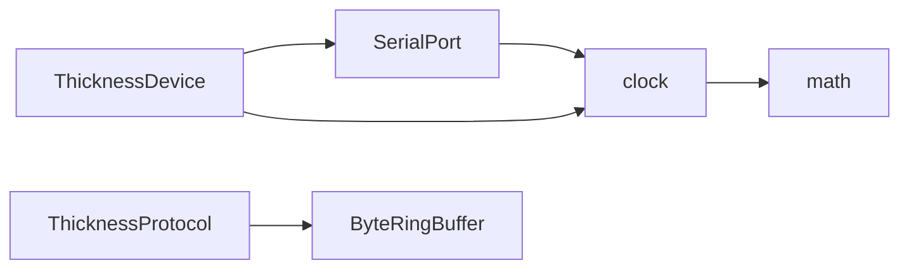

# robot_common 公共工具库

文档状态：现行  
实现状态：已构建并通过单元测试  
适用版本：2026-10-16 工作区未提交  
更新日期：2026-10-16

## 1. 目的与边界

`robot_common` 保存跨业务复用、无设备协议、无 ROS 节点状态且能独立测试的 C++ 基础能力。它不负责测厚协议、参数服务器、业务状态或摄像头采集。

## 2. 当前目录

```text
src/robot_common/
├── CMakeLists.txt
├── package.xml
├── README.md
├── include/robot_common/
│   ├── buffer/ByteRingBuffer.hpp   # 单线程有界字节缓冲
│   ├── clock/SteadyClock.hpp       # 单调时间与超时计算
│   ├── io/SerialPort.hpp           # Linux TTY 串口接口
│   └── math/Saturation.hpp         # 整数范围限制
├── module/
│   ├── SerialPort.cpp              # TTY 实现
│   └── SteadyClock.cpp             # 时间实现
└── test/
    ├── test_robot_common.cpp       # 时间和数学边界测试
    └── test_serial_port.cpp        # PTY 串口测试
```

## 3. API 契约

### 3.1 `robot_common::clock`

- `monotonic_time_now()`：返回 `std::chrono::steady_clock` 时间点。
- `elapsed_time_ms()`：计算年龄；未初始化时返回 `UINT32_MAX`，倒退时返回 0，溢出时饱和。
- `remaining_time_ms()`：计算到截止时间的剩余毫秒；到期返回 0，正的亚毫秒向上取整。

单调时间只用于超时、周期和耗时。ROS 消息时间戳继续使用节点时钟，不能把单调时间当作日期或系统时间。

### 3.2 `robot_common::math`

- `clamp_to_uint32()`：把有符号值限制到 `uint32_t` 范围。
- `clamp_to_nonnegative_int()`：把有符号值限制到非负 `int` 范围。

### 3.3 `robot_common::buffer::ByteRingBuffer`

提供固定容量的单线程字节流缓存，支持写入、查看、丢弃和清空。缓存不知道帧头、帧尾、CRC 或测厚字段；溢出后的业务处置由调用方决定。

### 3.4 `robot_common::io::SerialPort`

构造函数只保存 `device_path` 和 `baud_rate`。`open_port()` 才调用 Linux `open()`、`tcgetattr()` 和 `tcsetattr()`；`read_bytes()`、`write_bytes()` 使用 `poll()` 和总截止时间实现有界阻塞；析构时通过 RAII 关闭描述符。

当前支持 raw、8N1、无流控配置，适用于 `/dev/ttyACM*`、`/dev/ttyUSB*` 和板载 UART。它不负责广播、心跳、协议解码或重连策略。

## 4. 依赖关系



`robot_common` 不依赖 `thickness_usb_driver`，因此其他串口设备可以复用 I/O 层而不引入测厚代码。

## 5. 为什么不建立通用设备父类

串口、USB CDC 和摄像头都可能出现“打开/关闭”，但摄像头还需要 V4L2 格式协商、缓冲队列和流控制。当前没有足够稳定的共同契约，强行继承会把空实现、类型判断和业务分支带入父类。现阶段使用组合：具体设备持有适合自己的 I/O 对象。

## 6. 构建与测试

```bash
cd /workspace
source /opt/ros/jazzy/setup.bash
colcon build --packages-select robot_common
source /workspace/install/setup.bash
colcon test --packages-select robot_common --event-handlers console_direct+
colcon test-result --verbose
```

测试覆盖时间边界、整数饱和、伪终端双向读写、超时、部分写入和断开。设备协议和真实硬件验收不属于该包测试。

## 7. 新增公共工具的条件

1. 至少两个包存在明确复用场景，或该能力属于稳定的底层契约。
2. API 名称表达单位和边界，不引用具体业务类型。
3. 不连接真实硬件也能编写有意义的自动测试。
4. 同步修改包 README、模块文档、根代码树和当天开发记录。

时间设计采用 PX4 区分单调绝对时间、已用时间和单位的语义原则，但 Linux 上位机直接使用标准库 `steady_clock`，不复制 PX4 面向 NuttX 的硬件定时器实现。
