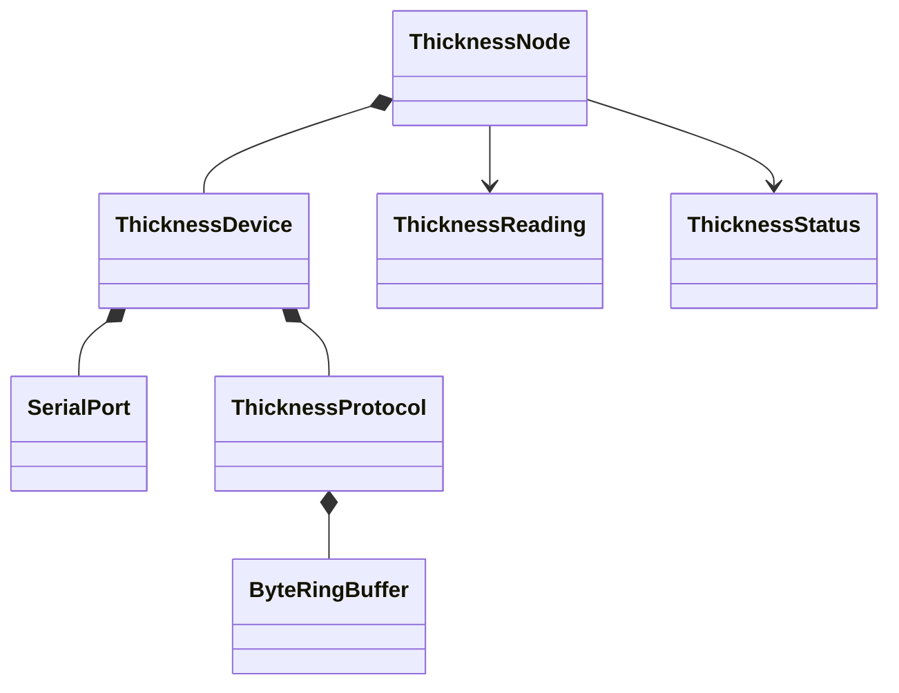
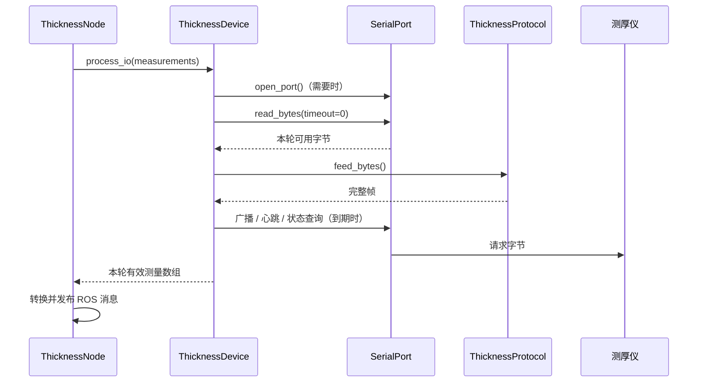

# 测厚采集模块设计说明

文档状态：现行  
实现状态：已实现并完成软件验证  
适用版本：2026-10-16 工作区未提交  
更新日期：2026-10-16

## 1. 目的与范围

本模块通过 Linux TTY 接口访问 USB CDC 测厚仪，完成设备发现、心跳、只读状态查询、测量报文解析，并向 ROS 2 发布原始测量值和通信状态。滤波、CSV、本地数据库、数传和测量启停门控不属于当前模块。

## 2. 结构与职责

| 类或模块 | 职责 | 不负责 |
|---|---|---|
| `ThicknessNode` | ROS 参数、定时器、消息转换与发布 | 打开端口、重连、协议状态判断 |
| `ThicknessDevice` | 通信会话、发现、心跳、查询、断线恢复和设备状态 | ROS 消息和日志 |
| `ThicknessProtocol` | 构帧、环形缓冲、拆包、CRC、字段解码 | 打开设备和重试策略 |
| `robot_common::io::SerialPort` | TTY 配置、文件描述符、限时字节读写 | 设备协议和业务状态 |
| `robot_common::buffer::ByteRingBuffer` | 单线程有界字节缓存 | 帧格式和溢出后的业务策略 |

主要源码：

- `src/thickness_usb_driver/src/ThicknessNode.cpp`
- `src/thickness_usb_driver/module/ThicknessDevice.cpp`
- `src/thickness_usb_driver/module/ThicknessProtocol.cpp`
- `src/robot_common/module/SerialPort.cpp`

## 3. 正常运行过程

节点每 10 ms 调用设备层；设备层每轮最多读取 8 次，每次读取 1024 字节。节点另用 500 ms 定时器发布状态，不参与通信是否正确的判断。

## 4. 配置与数据

`ThicknessDeviceConfig` 保存设备路径、波特率、厂家请求序列号和会话周期。`DecodedMeasurement` 是协议层输出的普通 C++ 测量结构。`ThicknessDeviceStatus` 汇总端口、在线状态、响应年龄、解析质量和最近错误。ROS 字段见 [ROS 接口与参数](../reference/ROS接口与参数.md)。

## 5. 状态与异常处理

| 情况 | 处理位置 | 行为 |
|---|---|---|
| 路径或波特率非法 | `ThicknessDevice` 构造 | 抛出参数异常，节点启动失败并打印原因 |
| `open`、`termios` 或 `poll` 失败 | `SerialPort` | 保存系统错误；不可恢复 I/O 错误关闭描述符 |
| 打开、读取或写入失败 | `ThicknessDevice` | 增加 I/O 错误计数、清理会话、等待重连 |
| CRC、长度或帧尾错误 | `ThicknessProtocol` | 丢弃坏数据、累计质量统计并继续同步 |
| 端口打开但尚无应答 | `ThicknessDevice` | 状态为 `CONNECTING` |
| 已识别设备但响应超时 | `ThicknessDevice` | 状态为 `STALE`，继续广播发现 |
| 有效应答未超时 | `ThicknessDevice` | 状态为 `ONLINE` |

端口打开只说明持有文件描述符，不等于仪器通信已经就绪。坏帧属于协议质量问题，不直接关闭端口。

## 6. 复用边界

`SerialPort` 可以复用于 `/dev/ttyACM*`、`/dev/ttyUSB*` 和板载 UART，只要设备使用支持的 TTY 配置。`ByteRingBuffer` 可以复用于其他字节流协议。广播、心跳、设备识别和测厚字段只属于 `ThicknessDevice` 与 `ThicknessProtocol`。

当前不建立摄像头、串口和所有 USB 设备的共同父类。摄像头需要 V4L2 缓冲、格式和流控制；它与串口仅有名称相似的打开/关闭操作，没有稳定的统一行为契约。

## 7. 设计依据

采用组合关系：`ThicknessDevice` 持有 `SerialPort` 与 `ThicknessProtocol`。原因和候选方案见 [ADR-0001](../decisions/ADR-0001-测厚模块分层方案.md)。

## 8. 验证

- `robot_common`：单调时钟和整数边界测试。
- `serial_port`：伪终端打开、双向读写、超时、部分写入和断开。
- `thickness_protocol`：已知报文、拆包/粘包、CRC、长度、重同步和浮点解码。
- `thickness_device`：伪终端打开、发送发现请求、解码、在线状态和断线恢复。
- 2026-10-16 构建：4 个 ROS 包成功；4 项测试，0 错误、0 失败、0 跳过。

## 9. 已知限制

- 本轮重构没有占用真实测厚仪；实机通信结论沿用重构前记录，重构后仍需回归。
- 当前仅支持固定的 raw、8N1、无流控串口配置。
- `process_io()` 是同步有界调用，不允许多个线程同时访问同一设备对象。
