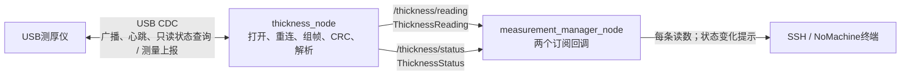
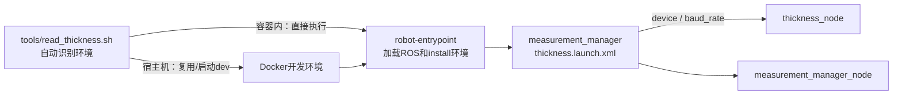

# 上位机节点通信图

更新日期：2026-10-15。以下是本轮简化后的当前代码，不是此前滤波、记录、MCU或参数管理目标图。

## 当前接口

| 接口 | 发布/服务端 | 订阅端 | 内容与QoS |
| --- | --- | --- | --- |
| /thickness/reading | thickness_node | measurement_manager_node | ThicknessReading；Reliable、KeepLast64、Volatile；每条打印 |
| /thickness/status | thickness_node | measurement_manager_node | ThicknessStatus；Reliable、KeepLast1、Volatile；变化时打印 |

读数是CRC和字段校验后的原始值，unit固定unknown；有限浮点数不等于精度已验收。状态在线只表示收到了新鲜协议应答，不能作为接触位置或机器人就绪信号。没有创建新的转发节点，measurement_manager当前不再发布业务结果。

device、baud_rate只是采集节点启动参数，XML通过arg/param传入，修改后重启；当前没有统一参数管理节点、参数动态更新回调或业务启停服务。

## 保留的后续方向

XRCE-DDS Client/Agent、应用心跳监测、下位机就绪/动作消息、测量状态数传、MK32设置界面和视频链路仍为规划，本轮不运行。未来数传节点订阅需要的测厚结果；视频单独走编码和网络，不通过测厚串口搬运。原MCU/Measurement消息已从当前接口包撤回，后续按需求逐个定义与验证。
